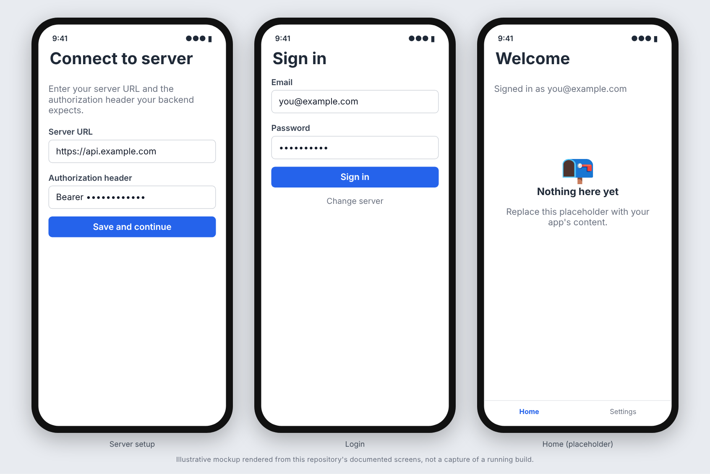

# Expo Router starter (Expo SDK 58)

A starter for an Expo SDK 58 app using expo-router, with a cookie-session login flow against a
user-supplied server, local auth state, push-notification registration and deep linking, a small
async hook, and a Jest + Testing Library setup.

## Screenshots



_Real screens of this template, not mockups. They were rendered through the Expo web build (`react-native-web`) in Chromium and driven with Playwright, signing in against a running backend that implements the same `/api/v1/auth/login` cookie-session contract. A web render is not a native iOS or Android capture: fonts and chrome differ, and `expo-notifications` has no web implementation, so it was stubbed for the capture and push behaviour is not shown._

## What is included

- `app/`: expo-router routes. `index` is the auth gate, `server-setup`, `login`, and an `(app)` group
  (guarded layout, `index` home placeholder, `settings` with device list and sign out).
- `lib/api-client.ts`: fetch wrapper with `ApiError` (`{ error: { code, message, field } }` body) and a
  cookie-based session. Add your endpoints to the `api` object.
- `lib/auth-context.tsx`: `AuthProvider`/`useAuth` with the `bootstrapping | needs-server | signed-out | signed-in`
  state machine. `lib/auth-storage.ts` and `lib/server-config.ts` persist hints in AsyncStorage.
- `lib/device-tokens.ts`, `use-register-device-on-sign-in.ts`, `device-registration-status.ts`: native FCM/APNs
  token registration on sign-in, with a status store the settings screen reads.
- `lib/push-notifications.ts`, `use-notification-deep-linking.ts`: tap-to-navigate for pushes whose data
  payload carries `{ "route": "/some/in-app/path" }` (only in-app absolute paths are accepted).
- `components/`: shared UI used by the login, server-setup and home screens: `Screen` (themed container,
  optional scroll / keyboard avoiding / centered), `Button` (`primary`, `danger`, `link`; `loading` shows a
  spinner and blocks presses), `TextField` (input with an optional field error), `ErrorMessage` (renders
  nothing when empty), `LoadingView`, `EmptyState` (optional action). `theme/colors.ts` holds the light and
  dark palettes and the `useColors()` hook (the app is pinned to light in `app.json`; change
  `userInterfaceStyle` to use the dark palette). Tests are in `components/__tests__/`.
- `lib/use-async.ts`: fetch-on-mount/refresh helper.
- `scripts/check-npm-audit.mjs`: `npm audit` gate with an empty, dated allowlist.
- Jest tests for every module above, `.github/workflows/ci.yml` (typecheck, lint, tests, bundle, audit,
  gitleaks, CodeQL for code and for Actions), `dependabot.yml`.

## Backend contract assumed

Under `/api/v1`: `POST /auth/login` (`{email,password}` returns `{user_id,email}` and sets an HttpOnly
session cookie), `POST /auth/logout`, `POST/GET /device-tokens`, `DELETE /device-tokens/{id}`. Change
`lib/api-client.ts` and `lib/api-types.ts` to match your server, or replace the server-setup screen with a
constant base URL if the app talks to one fixed backend.

## Use the template

```bash
./rename.sh myapp "My App" com.acme.myapp   # slug, display name, bundle/package id
# fill in LICENSE, then:
npm ci --legacy-peer-deps
npm run typecheck && npm run lint && npm test
npx expo start
```

`--legacy-peer-deps` is required: expo-router's optional peers conflict under npm's default resolver.

Push notifications need a development build and real credentials (FCM for Android, APNs for iOS); they do
not work in Expo Go or on simulators. Do not commit `google-services.json` or `GoogleService-Info.plist`
(both are gitignored).

## Known issue: npm audit allowlist is empty

At the time this template was created, `npm audit --omit=dev --audit-level=high` reports two high-severity
advisories reached only through Expo's build tooling (`braces`, GHSA-vfj7-8cjw-p6xm; `node-forge`,
GHSA-86w9-cpqp-85rv), with no upstream fix. `scripts/check-npm-audit.mjs` therefore fails until the
upstream packages are fixed or you add dated `ALLOWLIST` entries (after confirming they are
dev-tooling-only). Do not "fix" it with `npm audit fix --force`, which downgrades Expo.

Before writing code, read the versioned Expo docs: https://docs.expo.dev/versions/v58.0.0/ (see `AGENTS.md`).
